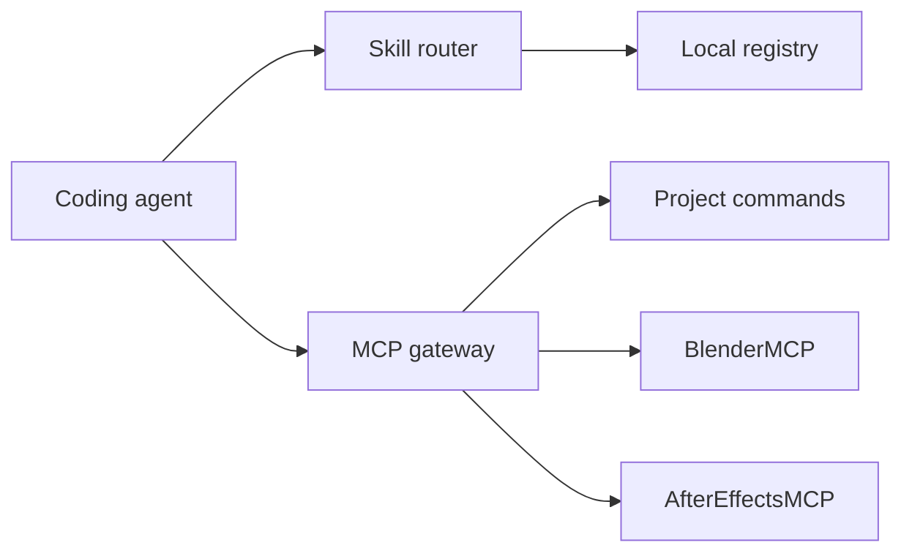
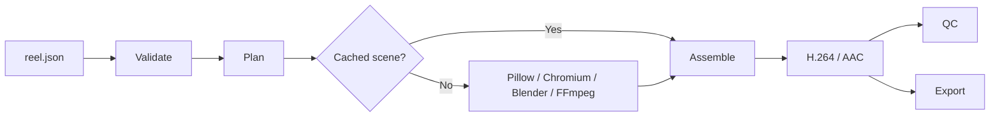
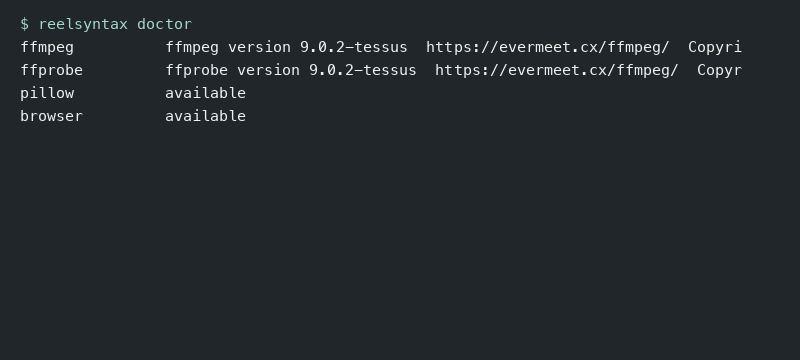
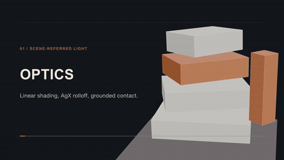

# ReelSyntax

Build and review a video from a local, frame-based project file.

[](https://github.com/Remirdy/ReelSyntax/actions/workflows/check.yml)
[](LICENSE)
[](pyproject.toml)
[](CHANGELOG.md)

[](docs/media/aperture-study.mp4)

## Who is it for?

ReelSyntax is for developers scripting repeatable video deliveries, editors exchanging frame-accurate timelines, and teams using a coding agent with Blender or After Effects. Renderers run locally. The Python core has no required third-party dependencies.

## Why ReelSyntax?

| Starting point | What ReelSyntax adds |
| --- | --- |
| An FFmpeg command | A validated project, a frame plan, scene caches, source hashes and a QC report for the encoded master |
| A Blender or After Effects project | A shared gateway that discovers downstream tools and loads the schema for the selected operation |
| A library of production instructions | One router for 616 skills, 123 validated in the effective registry. Search reads metadata and loads a selected skill on demand. |

See the [catalog and status breakdown](ReelSyntax_Skills/CATALOG.md), [runtime coverage](docs/runtime-coverage.md) and [development history](docs/development-status.md).

## How it works





## Requirements

| Component | Used for |
| --- | --- |
| Python 3.11+ | Required for CLI, routing, validation and the gateway |
| Pillow and FFmpeg/FFprobe | Raster frames, encoding and technical review |
| Playwright and matching Chromium | Canvas and WebGL recipes |
| Blender | Native 3D scenes and sequencer export. Aperture requires 5.1+ |
| After Effects | Interactive Adobe handoff through the optional integration |

## Quick start

From an activated environment in the checkout, install `python -m pip install '.[render]'` and put FFmpeg and FFprobe on PATH. Then run:

```sh
reelsyntax init ./my-film
reelsyntax render ./my-film --profile draft
reelsyntax qc ./my-film --profile draft --html
```

QC returns exit code 2 for findings that need review. In the recorded Draft run FFmpeg flagged a near-still interval in the opening assembly shot. Inspect the indicated frames in the report.



### Skill search

```sh
python3 -m reelsyntax doctor --json
python3 -m reelsyntax integrations --json
python3 -m reelsyntax skills search "sync PSD layers with voiceover" --json
python3 -m reelsyntax skills explain "keep the camera locked, no text" --stage plan
python3 -m reelsyntax skills load frame-clock
python3 -m reelsyntax skills validate
```

Warm metadata searches read zero specialist instruction bodies. Ranking supports English and Turkish morphology, negative clause exclusions, audio-vs-camera disambiguation, dependency closure, conflict filtering, capability allowlists (`--available`), and cumulative session context budgets.

Turkish queries such as `skills search "psd animasyon seslendirme senkronu"` use the same index. Selected aliases also cover German, Spanish, French and Portuguese. A reference loads only when requested and has its own SHA-256 and session budget charge.

```sh
python3 -m reelsyntax skills load j-cut --resource library/editing/j-cut/references/core-source-audio.md --project ./my-film --session sound-review --context-budget 6000
```

To install in an isolated virtual environment:

```sh
python3 -m venv .venv
. .venv/bin/activate
python -m pip install .
```

Optional rendering extras are `.[render]` (Pillow) and `.[browser]` (Pillow + Playwright). FFmpeg/FFprobe, Blender, and Adobe After Effects are separate local executables discovered automatically or configured via `REELSYNTAX_FFMPEG`, `REELSYNTAX_FFPROBE`, `REELSYNTAX_BLENDER`, `AE_BINARY`, and `AERENDER_BINARY`. Runtime commands never silently download software or contact remote services.

## Production workflow and quality control

```sh
python3 -m reelsyntax init ./my-film
python3 -m reelsyntax validate ./my-film
python3 -m reelsyntax plan ./my-film
python3 -m reelsyntax render ./my-film --profile draft
python3 -m reelsyntax render ./my-film --profile hero --fallback pillow
python3 -m reelsyntax qc ./my-film --profile hero
python3 -m reelsyntax diff ./my-film --base draft --target hero
python3 -m reelsyntax snapshot ./my-film --frame 45 --profile hero
python3 -m reelsyntax export ./my-film --format otio --profile hero
python3 -m reelsyntax export ./my-film --format fcpxml --profile hero
python3 -m reelsyntax export ./my-film --format blender --profile hero --frame 45
python3 -m reelsyntax cache ./my-film --max-mib 1024
python3 -m reelsyntax handoff ./my-film
```

- **Timing and color**: Canonical rational FPS (`24/1`, `30/1`, `30000/1001`) over sequential integer frames; OKLab perceptual color mixing, linear-light three-point 3D shading with AgX highlight rolloff, and explicit BT.709 VUI/MP4 color metadata.
- **Profiles and caching**: Content-addressed per-scene caches including source asset hashes, `resume` recovery, `checkpoint`/`restore` revisions, whole-scene locks, and lossless pre-encode `locked_regions` pixel protection. `hero` uses recipe-appropriate refinement and emits look development or shot study sheets plus motion extrema. `cache --max-mib N` previews unused-cache removal; add `--apply` to perform it, or pass `render --cache-budget-mib N` for post-delivery pruning. Caches referenced by current deliveries remain protected even when they exceed the requested budget.
- **Objective QC vs creative review**: `qc` verifies FFprobe stream contracts, full decode, 10-microsecond frame cadence, black/freeze/silence intervals, loudness and true peak, WCAG contrast ratios, `.notdef` glyph coverage (including Turkish `ÇĞİÖŞÜçğıöşü`), PCM cue-onset alignment, temporal continuity, and ROI locks. Technical pass never substitutes for human or host-agent visual and audio review.

## Example gallery

| Project | Preview | Poster |
| --- | --- | --- |
| [foundation](examples/foundation/) |  | [Still frame](docs/media/foundation.png) |
| [cinematic-study](examples/cinematic-study/) |  | [Still frame](docs/media/cinematic-study.png) |
| [editorial-study](examples/editorial-study/) |  | [Still frame](docs/media/editorial-study.png) |
| [shader-study](examples/shader-study/) |  | [Still frame](docs/media/shader-study.png) |

The [Aperture quality report](docs/quality.md) covers a 1280 × 720 master with 144 frames at 24 fps, H.264 video and a 48 kHz audio stream. Its frame cadence, decode and BT.709 metadata checks passed.

## Editor interchange

| Editor | Export | Verification |
| --- | --- | --- |
| Final Cut Pro | `export --format fcpxml` | XML structure, master reference and offsets tested. Import in Final Cut Pro is untested. |
| Adobe Premiere Pro | `export --format premiere` | Final Cut Pro 7 XML (xmeml), video and audio ranges tested. Import in Premiere Pro is untested. |
| DaVinci Resolve | `export --format fcpxml` | Frame rate and FCPXML timeline tested. Import in Resolve is untested. |

Render the selected profile first and keep its master accessible to the editor. Clips refer to ranges in that master and include the baked transitions.

## Unified MCP Gateway and agent host setup

Registering `python3 -m reelsyntax mcp` exposes a constant 9-tool progressive MCP surface (`reelsyntax_skills_*`, `gateway_search_tools` → `gateway_describe_tool` → `gateway_call_tool`, `reelsyntax_project_*`), routing across `blender:*` (`integrations/BlenderMCP`) and `after_effects:*` (`integrations/AfterEffectsMCP`) on demand without loading 570+ tool schemas into prompt context.

First-party integration management and host router installation:

```sh
python3 -m reelsyntax install blender --dry-run
python3 -m reelsyntax install after-effects --dry-run
python3 -m reelsyntax install --all
python3 -m reelsyntax update
python3 -m reelsyntax skills install ./my-film --host antigravity
python3 -m reelsyntax skills install ./my-film --host codex
python3 -m reelsyntax skills install ./my-film --host claude
python3 -m reelsyntax skills install ./my-film --host cursor
```

See [first-party MCP & submodule sync](docs/first-party-mcp.md), [CLI reference](docs/cli.md), [project format](docs/project-format.md), [quality](docs/quality.md), [competitive analysis](docs/research/competitive-analysis.md), [security](SECURITY.md), and [development status](docs/development-status.md).

<!-- TODO: add an "MCP Registry" section after the first release and mcp-publisher publish. -->

## Documentation and contributions

[Documentation site](https://remirdy.github.io/ReelSyntax/) · [Delivery commands](docs/delivery.md) · [CLI](docs/cli.md) · [Troubleshooting](docs/troubleshooting.md) · [Roadmap](docs/roadmap.md) · [Contributing](CONTRIBUTING.md) · [Security](SECURITY.md)

## Verification

```sh
python3 -m unittest discover -s tests -v
python3 -m unittest discover -s ReelSyntax_Skills/tests -v
python3 -m reelsyntax skills test
```

Enable full media and browser integration suites with `REELSYNTAX_MEDIA_TESTS=1` and `REELSYNTAX_BROWSER_TESTS=1`.

## License

MIT. Retain [`LICENSE`](LICENSE). Submodules and optional external tools carry their own licenses.
