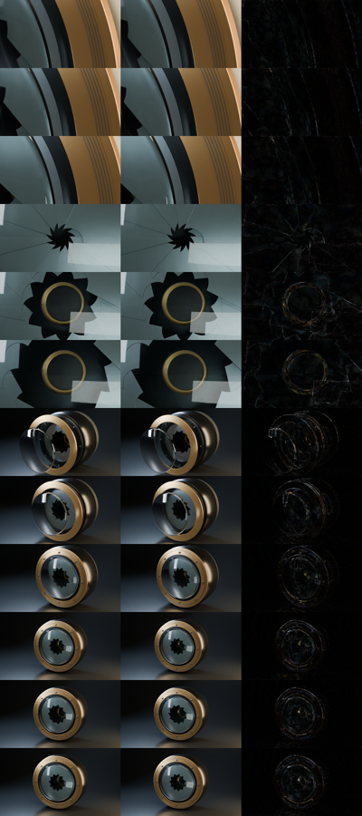

# CLI

`python3 -m reelsyntax --help` and `reelsyntax --help` expose only implemented commands. Standard CLI commands emit UTF-8 JSON on stdout; operational errors emit JSON on stderr and exit 2; `KeyboardInterrupt` exits 130. `reelsyntax mcp` runs the JSON-RPC 2.0 stdio gateway directly over stdin/stdout without CLI envelope wrapping.

| Command | Behavior |
| --- | --- |
| `config <show\|path\|init\|validate>` | Inspect merged `reelsyntax.toml` settings, print user/project config paths, create a starter TOML, or validate syntax and bounds |
| `lang <list\|show\|new\|validate>` | List supported locales and owner-verification flags, inspect a language profile, scaffold a new locale, or validate key/placeholder parity |
| `schema [--kind reel\|config] [--schema-version N]` | Print or write the versioned editor JSON Schema for `reel.json` or `reelsyntax.toml` |
| `migrate <project> [--dry-run]` | Upgrade legacy or unversioned `reel.json` files to `schema_version: 1` with `.reelsyntax/migrations/` backup |
| `doctor` | Probe Python, FFmpeg/FFprobe, Pillow, Chromium, Blender, After Effects/`aerender`, and first-party MCP status |
| `integrations` | Report submodule initialization, pinned commits, package versions, and runtime readiness for `BlenderMCP` and `AfterEffectsMCP` |
| `capabilities` | Refresh or progressively search namespaced `blender:*` and `after_effects:*` MCP tools without dumping full schemas |
| `install <blender\|after-effects\|--all>` | Reuse existing compatible local runtimes or initialize submodules and local environments (`--dry-run` supported) |
| `update [all\|blender\|after-effects]` | Check upstream submodule commits/tags (`--apply` to validate, schema-diff, and update; `--rollback` to restore last known good commit) |
| `mcp --workspace PATH` | Run the Unified MCP Gateway over stdio; scope project validation/planning/QC to PATH (default: current directory) |
| `init <directory>` | Write starter `reel.json` into a new or empty directory |
| `validate`, `plan`, `status` | Validate `reel.json`, inspect integer-frame sequential timeline, or read persisted render state |
| `render`, `resume` | Render/cache scenes (`draft`, `production`, `hero`), synthesize stems/mix, apply transitions, encode BT.709 MP4, and write review sheets (`--fallback pillow\|browser` optional) |
| `cache --max-mib N` | Preview LRU removal of recognized unreferenced scene caches; `--apply` removes them under the shared render lock |
| `ingest-psd --source PATH --destination DIR` | Extract supported local PSD raster layers into a new directory using an existing optional Node runtime |
| `qc` | Run FFprobe/decode/black/freeze/silence/loudness scans plus WCAG contrast, glyph coverage, cue-onset alignment, temporal continuity, and ROI lock checks |
| `snapshot --frame N` | Decode an exact frame from `output/<profile>.mp4` |
| `diff --base A --target B` | Compare two rendered profiles (`mae_rgb8`, `psnr_db`, audio RMS delta, and side-by-side visual diff sheet) |
| `export --format FMT` | Export `otio`, `fcpxml` (v1.10), `vtt`, `srt`, `svg`, or native `blender` editorial project |
| `handoff <project>` | Generate coordinated `BlenderMCP` + `AfterEffectsMCP` 3D camera/pass interchange manifest and dry-run validated `.jsx` |
| `lock --scene ID` | Lock whole-scene timing/source or `--roi-profile <profile>` protected pixel regions |
| `checkpoint`, `restore` | Save plan checkpoints and restore nondestructively with revision history |
| `skills search`, `explain` | Bounded metadata routing with stage plans, conflict filtering, and optional score/stem diagnostics |
| `skills load` | Explicit SHA-256 checked instruction or resource disclosure with optional cumulative `--session` budget |
| `skills list --category NAME` | Bounded metadata listing (`1..20`) |
| `skills validate`, `reindex`, `test` | Validate registry graph, rebuild `index.json` + `catalog.csv`, or evaluate the routing benchmark |
| `skills install`, `uninstall` | Receipt-tracked router installation for `codex`, `antigravity`, `claude`, and `cursor` |
| `skills record`, `effectiveness` | Caller-reported execution ledger backed by real artifact SHA-256 digests |

`skills load ID --resource PATH` returns only a declared, integrity-checked reference, including its content `sha256`. With `--project PATH --session ID`, a changed reference hash triggers a new budgeted load even when its skill instruction body is unchanged; unchanged content is deduplicated. Resources are not read by a warm metadata search or executed by loading them. `skills reindex` refreshes both the JSON registry and the atomically replaced UTF-8 CSV catalog.

Editorial exports reference the flattened `output/<profile>.mp4` master, segmented at scene boundaries. OTIO records baked transitions as clip metadata so an editor does not apply them twice. Its audio track uses the separate mix WAV when present and otherwise references the embedded master audio. Media URIs are absolute and percent-encoded; move or relink them when transferring the project to another workstation.

`export --format blender --profile hero --frame N` requires the rendered master and a separately installed Blender. It creates a native Video Sequencer `.blend`, reopens it headlessly and renders the selected frame to an adjacent PNG. It preserves the flattened picture cuts and mix; source effects and transitions stay baked. This is a ReelSyntax timeline adapter, not a general OTIO importer. Native Final Cut/Premiere/Resolve import remains a separate verification gate.

`render --cache-budget-mib N` optionally applies LRU cleanup after a verified delivery. Delivery/state-referenced caches remain protected, and the report's `within_budget` can be false if those caches alone exceed the requested size. Unknown cache entries, quarantine, source assets, output masters and history are excluded from pruning. `cache` is a dry-run unless `--apply` is supplied.

FCPXML dimensions follow the render profile, including Draft downscaling. Marker positions use the clip's source timeline, following Apple's [timing attributes](https://developer.apple.com/documentation/professional-video-applications/timing-attributes) and OTIO's [time-range rules](https://github.com/AcademySoftwareFoundation/OpenTimelineIO/blob/main/docs/tutorials/time-ranges.md). OTIO rates retain double precision and include the original rational rate as metadata. If an existing render manifest differs from the current plan, OTIO/FCPXML export fails with a request to render the revised plan. Export before any render remains supported and references the planned master location. SVG `--frame N` must be an integer inside the project's frame range; it exports a source storyboard schematic at project resolution, not a decoded video frame.

## Delivery and profile comparison

See [delivery commands](delivery.md) for templates, formats, locale tables, queue jobs and caption burn-in. The Aperture Draft/Hero comparison includes matched frames with per-sample MAE and PSNR. For its opening sample the mean absolute RGB error was 1.1209 on an 8-bit scale and PSNR was 42.479 dB.

