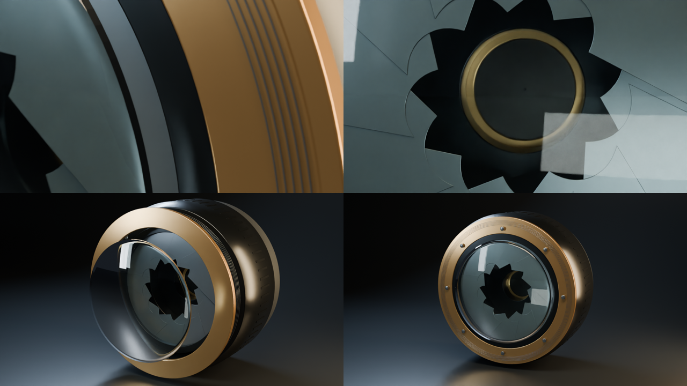
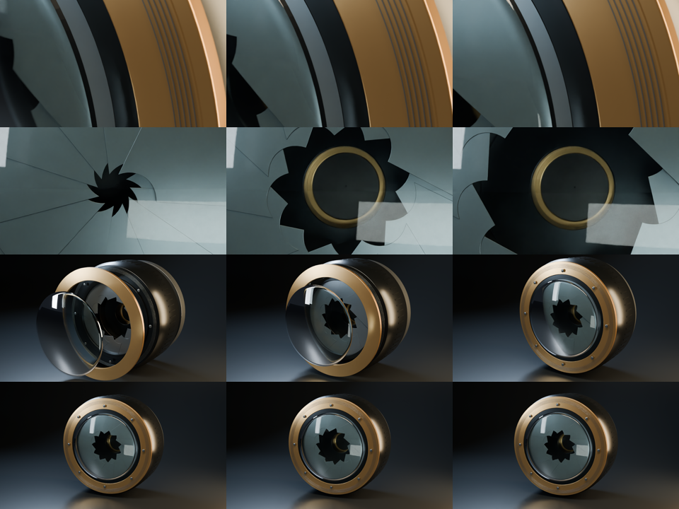

# Quality and evidence

ReelSyntax implements the objective technical gates of the [Production quality contract](../ReelSyntax_Skills/QUALITY_STANDARD.md) while keeping subjective creative evaluation explicit. No automated command certifies AAA artistic quality.

## Technical checks executed by `reelsyntax qc`

1. **Stream and container integrity**: FFprobe exact decoded frame count, even dimensions, rational frame rate, duration tolerance (`<= 1` frame), H.264/48 kHz AAC presence, and full `ffmpeg -xerror` null decode.
2. **Exact timestamp cadence**: Every decoded video frame `best_effort_timestamp_time` verified within `10` microseconds of `i / fps`.
3. **Color metadata**: Stream VUI and MP4 container verified for explicit `bt709` color space, transfer, primaries, and `tv` range.
4. **Anomaly and loudness scanning**: `blackdetect`, `freezedetect`, `silencedetect` (checked against bounded half-open `quality.exceptions`), integrated loudness measurement, and `true_peak <= -1.0 dBTP`.
5. **Typography contrast and glyph coverage**: Foreground/kicker vs background WCAG 2.2 luminance ratio (`>= 3.0:1` large / `>= 4.5:1` normal) plus `.notdef` missing-glyph rendering verification across all scene strings (including Turkish `ÇĞİÖŞÜçğıöşü`).
6. **Cue onset alignment**: Actual synthesized PCM waveform inspected around each declared `audio.cues` frame to confirm nonzero onset energy within `<= 2` video frames.
7. **Temporal continuity and ROI locks**: Intra-shot mean luminance spike screening and lossless pre-encode crop SHA-256 verification for locked pixel regions (`locked_regions`).

## Hero profile obligations

Selecting `--profile hero` uses `3x` Lanczos supersampling on CPU scenes (or `CYCLES` on headless Blender scenes) and generates `review/hero-lookdev-ab.png` (neutral vs AgX graded comparison) and `review/hero-motion-extrema.png`. `creative_review`, `cue_sync` playback perception, and `glyph_integrity` visual shaping remain `review` items requiring human or host-agent inspection of actual frames.

## Aperture review plates

The shot study arranges decoded samples by shot. The filmstrip provides an overview for review at transitions and holds.

Use `qc --html` to save a standalone report with measurements and an embedded filmstrip. Flash screening analyzes opposing luminance changes over sampled image areas. `qc --loop` also measures the decoded endpoint difference. Review flagged intervals at playback speed.

## UHD resource measurement

On an Apple silicon Mac, a 60-second 3840 × 2160 production render at 24 fps took 123.62 seconds for 1,440 frames. The scene held one local raster chart for the full duration, with no audio. The project occupied 46 MiB on disk after completion, including cache and output. macOS `/usr/bin/time -l` reported 1,328,533,504 bytes maximum resident set size. This measures a static, compressible fixture. Moving footage, transitions and Hero supersampling have different resource requirements.

Use `reelsyntax glyphs LOCALE --font /path/to/font.ttf` to check a local typeface against German, Spanish, Turkish, Polish, Vietnamese, Arabic, Chinese, Japanese or Korean sample characters. Project QC also tests the actual text strings. Joined-script shaping requires a visual check.
