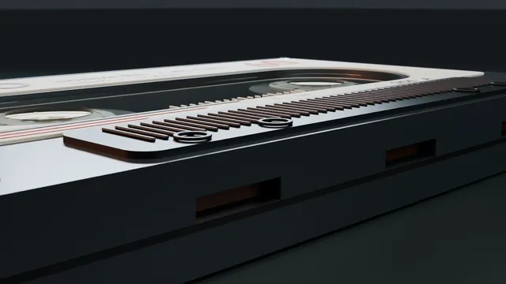

# FERRO 60

A six-second product film of a compact cassette, built from geometry and lit with studio area lights in Blender Cycles. The shallow camera angle in the opening shot picks out the grip ribs. The cut to the rotating hub reveals the mechanism under the acrylic window. The camera then tracks across the paper label and pulls back for the first full view of the cassette.

[](../../docs/media/cinematic-study.mp4)

[Watch the 1080p film with stereo sound](../../docs/media/cinematic-study.mp4) · [View the poster](../../docs/media/cinematic-study.png)

| Frames at 24 fps | Shot | Sound |
| --- | --- | --- |
| 0–31 | Low tracking shot along the shell | Transport click over a low hum |
| 32–67 | Macro shot of the rotating drive | Low impact on the cut |
| 68–95 | Move across the printed label | A short whoosh leads into the cut |
| 96–143 | Pullback to the full cassette | Two plucked tones across the reveal |

## Render the film

From the repository root, install the render extra and make Blender, FFmpeg and FFprobe available. Set `REELSYNTAX_BLENDER` to the Blender executable if it is outside your path.

```sh
python3 -m pip install -e '.[render]'
python3 -m reelsyntax validate examples/cinematic-study
python3 -m reelsyntax render examples/cinematic-study --profile hero --timeout 2400
python3 -m reelsyntax qc examples/cinematic-study --profile hero
```

The master is written to `output/hero.mp4` inside the example. All 144 frames are rendered at 1920 × 1080. The cassette, camera moves, lights and sounds are generated locally.
